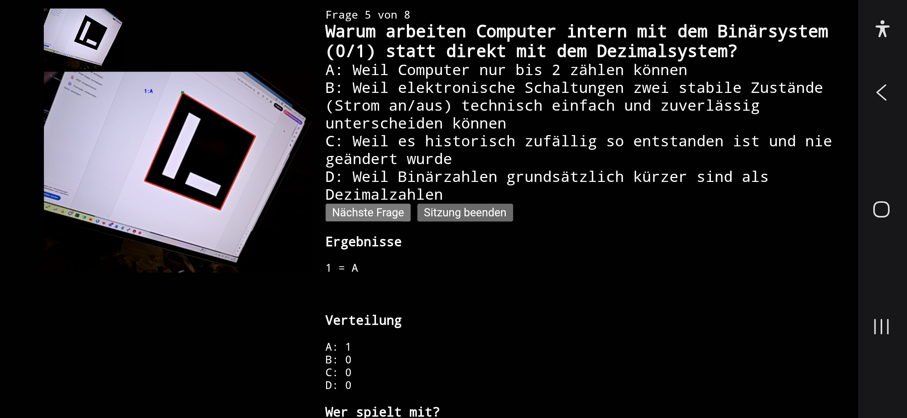

# NoNameQuiz

A browser-based, camera-driven quiz tool for classrooms. Instead of clickers or a
phone app, each participant holds up a printed card with a unique **ArUco marker**.
The camera watches the room, recognizes each card by its marker ID, and reads the
answer (**A/B/C/D**) from which corner of the card is currently pointing up — so
answering a question is just a matter of rotating your card.

Teachers manage question sets (in Excel, by hand, or AI-generated), run quizzes
with the camera, and review results per question, per class, and per card number
— in the app or as Excel files.

Built on top of [js-aruco2](https://damianofalcioni.github.io/js-aruco2/) for marker
detection and [SheetJS](https://sheetjs.com/) for Excel files. Questions, sessions
and results are stored locally in the browser via IndexedDB — the app itself is
client-only with no backend or build step (see [features.md](features.md) and
[architecture.md](architecture.md) for the feature/architecture rationale). The one
exception is optional AI-generated question sets (F8), which use a small stateless
[proxy server](server/).

**For teachers:** a German step-by-step guide is built into the app —
[anleitung.html](anleitung.html) (button "Anleitung" in the header).



## Requirements

- A device with a camera (phone, tablet, or laptop) and a modern browser
  (Chrome/Safari/Firefox/Samsung Internet on Android/iOS/desktop).
- **HTTPS, or `localhost`.** Browsers only grant camera access (`getUserMedia`) on
  secure origins, so opening `index.html` via `file://` will fail — serve it over
  `https://` or run it locally (see below).
- One printed ArUco marker card per participant, each with a distinct ID. You can
  generate marker images with the
  [js-aruco2 marker generator](https://damianofalcioni.github.io/js-aruco2/) (dictionary:
  `ARUCO`). ID `0` is reserved/ignored by the app, so start numbering from `1`.

## Setup

Clone the repo and serve the folder with any static file server, for example:

```bash
git clone https://github.com/cndrbrbr/NoNameQuiz.git
cd NoNameQuiz
python3 -m http.server 8000
```

Then open `http://localhost:8000/index.html` on the device that will act as the
camera/host. For a phone that isn't `localhost`, serve it over HTTPS (any static
host with TLS, e.g. nginx behind Caddy, GitHub Pages, `ngrok`).

The AI question generation additionally needs the proxy in [server/](server/), see
[server/README.md](server/README.md).

## Preparing marker cards

Each participant needs a physical card with one ArUco marker on it (dictionary
`ARUCO`, any ID except `0`). Whichever corner is held pointing **up** encodes the
answer:

| Top corner | Answer |
|---|---|
| corner 0 | A |
| corner 1 | B |
| corner 2 | C |
| corner 3 | D |

Print each marker with the letters A/B/C/D next to the corresponding corners, so
participants just rotate the card to the letter they want.

**Detection robustness:** a card only counts when the marker was decoded
**exactly** (`maxHammingDistance: 1`; js-aruco2's default for `ARUCO` tolerates 2
wrong bits, but codes in this dictionary are only 3 bits apart, so misreads turned
into IDs that don't exist) and the same ID + answer was seen in **3 consecutive
frames** (`CONFIRM_FRAMES` in `index.html`). Unconfirmed markers are labelled grey
in the camera view, confirmed ones blue.

## Usage

The app has three tabs: **Quiz** (live round), **Fragen** (question sets) and
**Auswertung** (results). It opens on the Quiz tab.

### 1. Fragen — question sets

- **Excel** (recommended): "Excel-Vorlage herunterladen" gives a template (title,
  subject, then one question per row: text, answers A–D, correct letter). Upload
  with "Excel-Datei hochladen"; every sheet becomes its own question set, a sheet
  without a "Frage" header row (e.g. "Anleitung") is ignored. Errors name sheet and
  row; a faulty sheet is rejected as a whole. Template cells are text-formatted so
  "1/2" doesn't become a date.
- **AI** ("Mit KI erstellen"): subject, topic, count, optional teaching material
  (.txt/.md/.pdf, stored per subject and sent along as context). The proposal
  opens in the editor for review before saving (`origin = "ai"`).
- **Manual** ("Selbst schreiben"): type questions into the editor.
- In the editor, "Als Excel herunterladen" exports the current (unsaved, possibly
  incomplete) draft, e.g. to review an AI proposal in Excel.
- "Weitere Möglichkeiten": JSON upload (format in
  [architecture.md](architecture.md#format-für-den-fragen-upload-json)) and a sample
  set.
- **Meine Fragensets**: per set "Excel" (download), "Löschen" (confirm; sets that
  were already used in a quiz are only hidden so results stay intact), "Quiz
  starten"; plus "Alle Fragensets als Excel herunterladen".
- **Daten sichern**: full backup of all data as one JSON file and restore/merge on
  any device (`backup.js`).

### 2. Quiz — run a live round

1. Pick a **Fragenset**, enter **Klasse** (subject is taken from the set). **Anzahl
   Fragen** defaults to all questions of the set, at most 30. A hint shows how many
   questions are new / not yet mastered / mastered for that class.
2. "Quiz starten", "Kamera starten", point the camera at the room.
3. **Wer spielt mit?** Recognized cards are collected; "Alle da – los geht's" locks
   attendance — only those cards are counted from now on. "Teilnehmende ändern"
   reopens it, with a `+17 -18` editor.
4. Participants rotate their card to their answer; live bars show the A–D
   distribution, "Noch offen" who hasn't answered.
5. "Nächste Frage →" stores the answers and advances; after the last question the
   session completes. "Quiz beenden" ends early (answers of completed questions are
   kept).

**Question selection** (`Analysis.prioritize`): for the chosen class, questions are
picked and asked in this order — new for this class → asked but never ≥60 % correct
in this class (worst first) → already mastered (longest ago first); within a group
the set order is kept. Questions are identified by their normalized text, so
history carries over to re-uploaded or copied sets.

### 3. Auswertung — results

Filter by Fach/Klasse, pick a quiz from the list:

- per question: A/B/C/D counts (correct answer highlighted), correct/total, %,
  and a total row;
- **right/wrong per card number**: each card's answer per question with ✓/✗ and
  its score;
- "Schwierige Fragen finden": questions with ≥40 % errors can be turned into a
  "Wiederholung …" question set (currently a verbatim copy, see below).

**Fragen über alle Quiz** (bottom): per question, how often A/B/C/D were chosen
across all quizzes (respecting Fach/Klasse and an optional Fragenset filter, which
also lists never-asked questions) and **when it was asked to which class** with the
share of correct answers (green ≥60 %).

Exports:

| Button | Content |
|---|---|
| Als Excel herunterladen (quiz) | sheets "Fragen" (counts, %, total row) and "Karten" (✓/✗ per card) |
| Excel pro Klasse herunterladen | one workbook per class (or the selected one): questions cumulated with "asked on", quiz overview, cards across all quizzes, one ✓/✗ sheet per quiz, all answers |
| Alle angezeigten Ergebnisse als Excel herunterladen | all filtered quizzes: overview, questions cumulated, one row per answer |
| Diese Übersicht als Excel herunterladen | exactly the "Fragen über alle Quiz" table with its filters |
| Kopieren (für OneNote) / Als CSV herunterladen | per quiz, HTML table to clipboard / CSV |

### Presentation mode (smartboard)

Rotating the phone to **landscape** switches the Quiz tab to a two-column layout
for a 16:9 screen (camera, question, results left; teacher controls right), meant
for mirroring the phone to a smartboard (Miracast/AirPlay/Chromecast/HDMI).
"Beamer-Ansicht" additionally shrinks the controls and enlarges question, answers
and results. See [architecture.md](architecture.md#präsentationsmodus-smartboard).

### AI question generation (F8)

Talks to a small [proxy server](server/) rather than an AI API directly, so no
key ever lives in client-side JS. It forwards to a self-hosted, OpenAI-compatible
Mistral/Ollama endpoint, validates the result (text, four options, correct letter)
and stores nothing. Point `proxyBaseUrl` in [ai-service.js](ai-service.js) at it if
it isn't on the same origin; if the proxy sets `PROXY_ACCESS_TOKEN`, put the same
value into `accessToken` there (deployment-local, don't commit it).

### Not implemented yet

**F9**'s AI-rewritten review questions and **F10** (AI tips for the teacher) reuse
the same proxy but aren't wired up yet — see
[architecture.md](architecture.md#ki-komponente-fragengenerierung--tipps). Until
then, the review set re-offers the original questions unchanged.

## Project structure

```
index.html              — app shell, tabs, camera loop, marker → answer logic (3-frame confirmation)
anleitung.html          — step-by-step guide for teachers (German)
store.js                — IndexedDB data layer (subjects, classes, question sets, questions,
                          sessions, answer records, materials)
question-editor.js      — question set upload (Excel, JSON), manual editor, AI-draft review,
                          set list (Excel export, delete)
excel.js                — Excel template/import of question sets; Excel export of sets, drafts
                          and results (per quiz, per class, cumulative, all answers)
analysis.js             — cross-quiz statistics (per question / class / card), question identity
                          by text, prioritisation for the next quiz
quiz-runner.js          — quiz flow: question selection, current question, saving answers
stats-view.js           — Auswertung tab: quiz list, quiz detail, per-card table, cumulative view
review.js               — error rate per question, review-set generation
backup.js               — full backup/restore as JSON
materials.js            — per-subject teaching material (context for AI generation)
ai-service.js           — talks to the AI proxy (server/) to generate a question set (F8)
export.js               — clipboard HTML-table copy, CSV/file download helpers
vendor/xlsx.full.min.js — vendored SheetJS 0.20.3 (Apache-2.0)
aruco.js, cv.js         — vendored js-aruco2 marker detector
polyfill.js             — getUserMedia / browser compatibility shims
server/                 — minimal Node/Express AI proxy (F8), see server/README.md
sample-data/            — example question set (JSON)
history/                — archived earlier iterations of index.html, kept for reference
```

## Credits

Marker detection by [js-aruco2](https://damianofalcioni.github.io/js-aruco2/), Excel
files by [SheetJS](https://sheetjs.com/) Community Edition.
